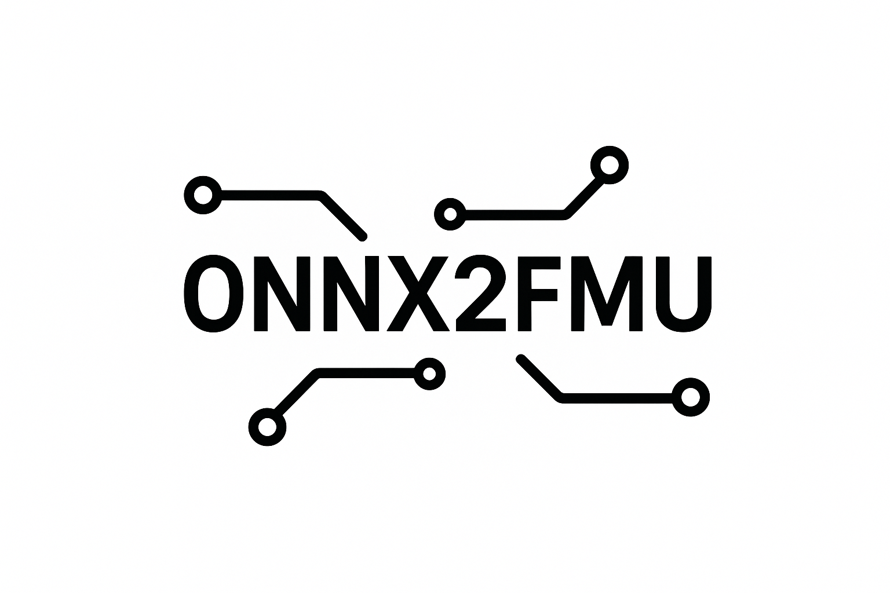
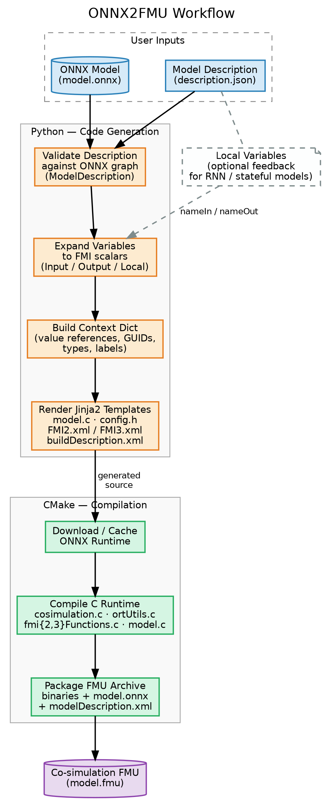

<p align="center">
<picture>
  <source media="(prefers-color-scheme: dark)" srcset="https://github.com/HyRES-FBK/onnx2fmu/blob/33-examples/logos/onnx2fmu-logo-white-transparent.png?raw=true">
  <source media="(prefers-color-scheme: light)" srcset="https://github.com/HyRES-FBK/onnx2fmu/blob/33-examples/logos/onn2fmu-logo-black-transparent.png?raw=true">
  
</picture>
</p>

# ONNX2FMU: Encapsulate ONNX models in Functional Mock-up Units (FMUs)

**What do ONNX2FMU do?** It wraps [ONNX](https://onnx.ai/) models into
co-simulation FMUs.

## 🚀 Get started

- Python 3.11+
- CMake 3.22+
- A code compiler for the host platform, which could be one of Linux, Windows
or MacOS.

The default Windows CMake Generator is Visual Studio 2022.

To install ONNX2FMU use
```bash
pip install onnx2fmu
```
in your shell.
You don't need to install CMake because it will be installed with the Python
package, but you need to install a C compiler (e.g., Visual Studio in Windows,
gcc in Linux, etc.).

## 🏗️ Architecture

ONNX2FMU turns an ONNX model plus a JSON model description into a co-simulation
FMU. The pipeline has a Python code-generation half and a C runtime half:

<p align="center">

</p>

1. **Validate** — the model description JSON is checked against the ONNX
   graph: every declared input/output `name` and every feedback state
   `nameIn`/`nameOut` must match a graph node, and the `nameIn`/`nameOut`
   node shapes of a feedback state must agree.
2. **Expand variables** — each tensor input, output, and feedback state is
   expanded into a flat list of FMI scalar variables (one per tensor element), with per-element
   names, optional labels, and broadcast start values. Feedback states wire
   an output node back into an input node on the next simulation step, which
   is how RNN-style stateful models are supported.
3. **Build context** — the expanded variables are assigned sequential FMI
   value references, together with a GUID and timestamps, into a single
   context dictionary.
4. **Render templates** — the context is rendered through Jinja2 templates to
   produce the generated C sources (`model.c`, `config.h`) and the FMU
   descriptors (`buildDescription.xml`, `FMI2.xml`/`FMI3.xml`).
5. **Compile** — CMake downloads/caches a pinned ONNX Runtime release,
   compiles the generated `model.c` against the static C runtime
   (`cosimulation.c`, `ortUtils.c`, `fmi{2,3}Functions.c`), and packages
   everything — including the original `model.onnx`, loaded at runtime rather
   than compiled into C — into the final `.fmu` archive.

## 📝 ONNX model declaration

ONNX2FMU can handle models with multiple inputs, outputs, and feedback states.
These entries must be listed in the model description JSON file, and their
names must match the name of a node in the ONNX model graph.

### Model description file

A model description is declared in a JSON file and its schema includes the
following global items:

- `"name"` is the model name, which will also be the FMU archive name;
- `"description"` provides a generic description of the model;
- `"FMIVersion"` is the FMI standard version for generatign the FMU code and
the FMU binaries, which can be either `2.0` or `3.0`;
- `"inputs"` and `"outputs"` are the lists of inputs and output nodes in the
ONNX model;
- `"feedbackStates"` (optional) are mappings between an output node and the
input node it is fed back into on the next step. Their behavior is explained
in [A model with feedback states](#a-model-with-feedback-states). This key was
previously named `"locals"`; the old name still works but is deprecated and
emits a warning.
- `"FMUType"` (optional) selects which FMI interface(s) to generate: a list
made of `"CoSimulation"`, `"ModelExchange"`, or both. It defaults to
`["CoSimulation"]`, so existing model descriptions keep producing the same
FMU. See [Model Exchange and continuous
states](#model-exchange-and-continuous-states).

Each entry of the the inputs and output lists is characterized by the following
schema:

- `"name"` must match the name of one of the model nodes, whereas
- `"labels"` is the list of user-provided names for each of the node elements.
The number of names in the `"labels"` list must match the number of elements of
a given entry.
- `"description"` allows the user to attach a description to each of the
arrays.

The following is an example of a model description for a model with three
input nodes and one output node.

```json
{
    "name": "example1",
    "description": "The model defines a simple example model with a scalar input and two vector inputs.",
    "FMIVersion": "2.0",
    "inputs": [
        {
            "name": "scalar_input",
            "description": "A scalar input to the model."
        },
        {
            "name": "vector_input",
            "description": "A vector of 4 input variables; variability is continuous by default."
        },
        {
            "name": "vector_input_discrete",
            "description": "A vector of 5 input variables; variability is continuous by default."
        }
    ],
    "outputs": [
        {
            "name": "output",
            "description": "The output array.",
            "labels": [
                "Class1",
                "Class2",
                ...
            ]
        }
    ]
}
```

### Terminology

ONNX2FMU and the FMI standard use a few similar-sounding words for different
things:

| Term | Meaning | How it is declared |
|---|---|---|
| **Feedback state** | An output node whose value is fed back into an input node on the next step (e.g. the hidden state of an RNN). An ONNX2FMU concept. | An entry of `"feedbackStates"` with `nameIn`/`nameOut`. |
| **Continuous state** | A state integrated by the importer's solver in Model Exchange, paired with an output that computes its derivative. An FMI concept. | An input targeted by an output's `"derivativeOf"`. |
| **FMI `local` causality** | The FMI attribute of a variable that is internal to the FMU and not meant to be connected to other models. | Not declared: it is assigned in the generated `modelDescription.xml`. |

Feedback states and continuous-state derivatives are both *emitted* with FMI
`local` causality, but `local` is only an attribute of the generated FMU
variables, not a kind of entry in the model description.

### Variability of model variables

Admissible variabilities are `continuous` and `discrete`;
the default choice is `continuous` if nothing is specified in the model
description.

### Model declaration: A PyTorch example

ONNX2FMU works with any ONNX model, which can be generated by all the major
ML/DL frameworks, e.g., PyTorch, TensorFlow, Scikit-Learn, etc.
However, we chose PyTorch to show how ONNX2FMU works.

To run the examples, clone the repository and install development dependencies.
If you are using [uv](https://docs.astral.sh/uv/), you can install them with

```
uv sync --all-extras
```

if you are using `pip`

```
pip install ".[extra]"
```

The following model is used in `tests/example1` to perform some basic vector
operations.
```python
class ExampleModel(nn.Module):

    def __init__(self):
        super(ExampleModel, self).__init__()

    def forward(self, x1, x2, x3):
        # Input x1 is a scalar
        # Input x2 is a vector with 4 elements
        # Input x3 is a vector with 5 elements
        x4 = x2 + x3[:4]
        x5 = x2 - x3[:4]
        x6 = x1 * x3[-1]
        x7 = x1 / x3[-1]
        x = torch.cat([x4, x5, x6, x7])
        return x
```
All the basic array operations are allowed, which is useful to define not only
deep learning models, but also generic, graph-based models.

A more complex examples is explained in `tests/example3`, where an RNN model
is used to predict the temperature of a point on a metallic plate.
The model is declared as follows
```python
class HeatRNN(nn.Module):
    def __init__(self, input_size, hidden_size, output_size, num_layers, norm_params):
        super(HeatRNN, self).__init__()
        x_min, x_max, y_min, y_max = norm_params
        self.register_buffer("x_min", torch.tensor(x_min))
        self.register_buffer("x_max", torch.tensor(x_max))
        self.register_buffer("y_min", torch.tensor(y_min))
        self.register_buffer("y_max", torch.tensor(y_max))
        self.rnn = nn.RNN(input_size, hidden_size, num_layers, batch_first=True)
        self.fc = nn.Linear(hidden_size, output_size)

    def forward(self, x, h=None):
        x = (x - self.x_min) / (self.x_max - self.x_min)
        out, _ = self.rnn(x, h)
        out = self.fc(out)  # Predict next time step
        out = out * (self.y_max - self.y_min) + self.y_min
        return out
```
In this example, the normalization parameters, which do not have to be
optimized, are stored in the model using the [`register_buffer`](https://pytorch.org/docs/stable/generated/torch.nn.Module.html#torch.nn.Module.register_buffer) method, which
detaches them from the computational graph.

### A model with feedback states

Recurrent neural network architectures might require to feed the model with the
output of the model itself in a feedback loop fashion.
In ONNX2FMU, we realize this functionality through *feedback states*, which
map an output node of the model to one of its input nodes.
In [example4](examples/example4/), we show how FMUs with feedback states are
declared.
The model description file must present a section named `feedbackStates` like
the following:

```json
{
    ...
    "feedbackStates": [
        {
            "nameIn": "X",
            "nameOut": "X1",
            "description": "The history of states from t-N to t."
        },
        {
            "nameIn": "U",
            "nameOut": "U1",
            "description": "The history of control variables frmo t-N to t-1."
        }
    ]
}
```

A feedback state requires two names, i.e., `nameIn` and `nameOut`, which define
an input-output relationship that feeds the `nameIn` input node with the
output of the `nameOut` output node.
The user must take care to provide the right output in the `forward` method.
In `example4`, the relationship between input `U` and output `U1` is defined
as follows

```python
class ExampleModel(nn.Module):

    def __init__(self):
        super(ExampleModel, self).__init__()

    def forward(self, u, U, X):
        U1 = torch.concat((U[1:, :], u))
        x = torch.stack([U1[-3, 0], U1[-2, 1], U1[-1, 2]]).unsqueeze(0)
        X1 = torch.concat((X[1:, :], x))
        return x, X1, U1
```

In the example above, the input `U` is updated with the content of `u` and
returned by the function with the name `U1` (remember that node names cannot be
repeated in ONNX). During the next time step, the FMU will take care to pass
the output to the model as a new, updated input.

In the generated FMU, each feedback state is exposed as a variable named
`<nameIn>_<nameOut>` with FMI `local` causality.

### Model Exchange and continuous states

ONNX2FMU can also generate **Model Exchange** (ME) FMUs, for models whose
outputs are interpreted as state derivatives `dx/dt` (a "neural ODE"): the
FMU exposes `getContinuousStates`/`setContinuousStates`/`getDerivatives` and
lets the *importer's own solver* (e.g. CVode) integrate the network, instead
of ONNX2FMU stepping it internally as in Co-Simulation.

To opt in, set `"FMUType"` to include `"ModelExchange"`, and mark an output
as the derivative of an input with `"derivativeOf"`:

```json
{
    "name": "VanDerPol",
    "description": "Van der Pol oscillator (mu=1) as a neural-ODE FMU.",
    "FMIVersion": "3.0",
    "FMUType": ["ModelExchange", "CoSimulation"],
    "inputs": [
        {
            "name": "x",
            "description": "State vector [x0, x1].",
            "start": [2.0, 0.0]
        }
    ],
    "outputs": [
        {
            "name": "dx",
            "description": "dx/dt, the derivative of state x.",
            "derivativeOf": "x"
        }
    ]
}
```

A few consequences of declaring a state this way:

- The state input (`"x"` above) is **required** to declare a `"start"`
value — it is its initial condition — and is emitted in the FMU as an
`output`-causality variable with `initial="exact"`, not as a regular input.
This mirrors the FMI specification's own [Van der
Pol](https://github.com/modelica/Reference-FMUs/tree/main/VanDerPol)
reference example.
- The derivative output (`"dx"` above) is emitted as a `local`-causality,
`initial="calculated"` variable carrying the FMI `derivative` attribute
that points back at its state.
- Both the state and its derivative must reference ONNX nodes of the same
shape.
- `"FMUType": ["ModelExchange"]` is **not compatible with
`"feedbackStates"`**: feedback states would otherwise advance at whatever rate the
ME solver happens to evaluate the model, not once per communication step.
Declaring both raises a validation error.

For time-dependent (non-autonomous) dynamics `f(t, x)`, an input can be
flagged `"time": true` instead of receiving its own FMI variable; ONNX2FMU
feeds it the FMI independent variable (the simulation clock) on every
evaluation:

```json
{"name": "t", "time": true}
```

A model can declare at most one time input, and it must have a single
element (it cannot itself be a state).

**Co-Simulation of a model with continuous states** is still possible (e.g.
`"FMUType": ["ModelExchange", "CoSimulation"]`) but integrates internally
with a fixed-step forward Euler at the hardcoded 1 second step
(`FIXED_SOLVER_STEP`) — coarser than letting an ME importer's adaptive
solver drive it. Use plain Model Exchange, or a small Co-Simulation
communication step, for accuracy-sensitive cases.

[example5](examples/example5/) trains an actual neural ODE with
[torchdiffeq](https://github.com/rtqichen/torchdiffeq) — a small network
`f_theta(t, x)` fit, via backpropagation through `torchdiffeq.odeint`, to
approximate a forced Van der Pol oscillator — and wraps it as a Model
Exchange FMU using `derivativeOf` and `time` exactly as described above.

## 🔨 ONNX model generation

ONNX2FMU provides two ways to build an FMU from an ONNX model.

### CLI

ONNX2FMU is designed as command line application first. The `build` command
requires the ONNX model path and the model description path

```bash
onnx2fmu build <model.onnx> <modelDescription.json> [OPTIONS]
```

### Built-in functions

FMUs of ONNX models can be build from a Python script by calling the `build`
function from `app.py`.
This is particularly useful when training a model and generating the FMU in
the same file.

### Generation and compilation

ONNX2FMU provides the possibility to separate generation of the FMU code
and its compilation.
This can be achived using the commands `generate` and `compile`, respectively.
To see the documentation of the commands, one can use
```bash
onnx2fmu [generate|compile] --help
```
Separating FMU code generation and compilation allows a user to customize the
the FMU source code.

## Acknowledgements

The code in this repository is inspired to the [Reference FMU](https://github.com/modelica/Reference-FMUs/)
project.

## References

If you found this library useful in your research, please consider citing.

```
@inproceedings{urbani2025tool,
  title={A Tool for the Implementation of Open Neural Network Exchange Models in Functional Mockup Units},
  author={Urbani, Michele and Bolognese, Michele and Prattic{\`o}, Luca and Testi, Matteo},
  booktitle={Modelica Conferences},
  pages={645--651},
  year={2025},
  doi={https://doi.org/10.3384/ecp218645}
}
```